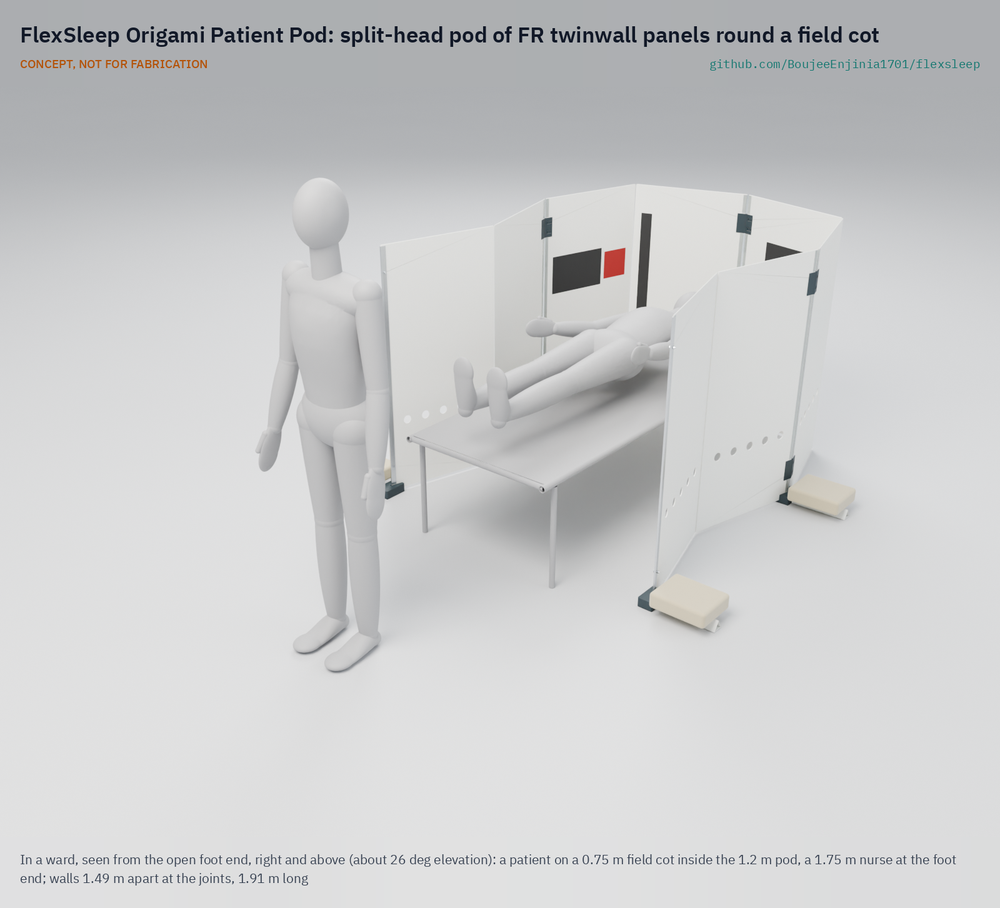
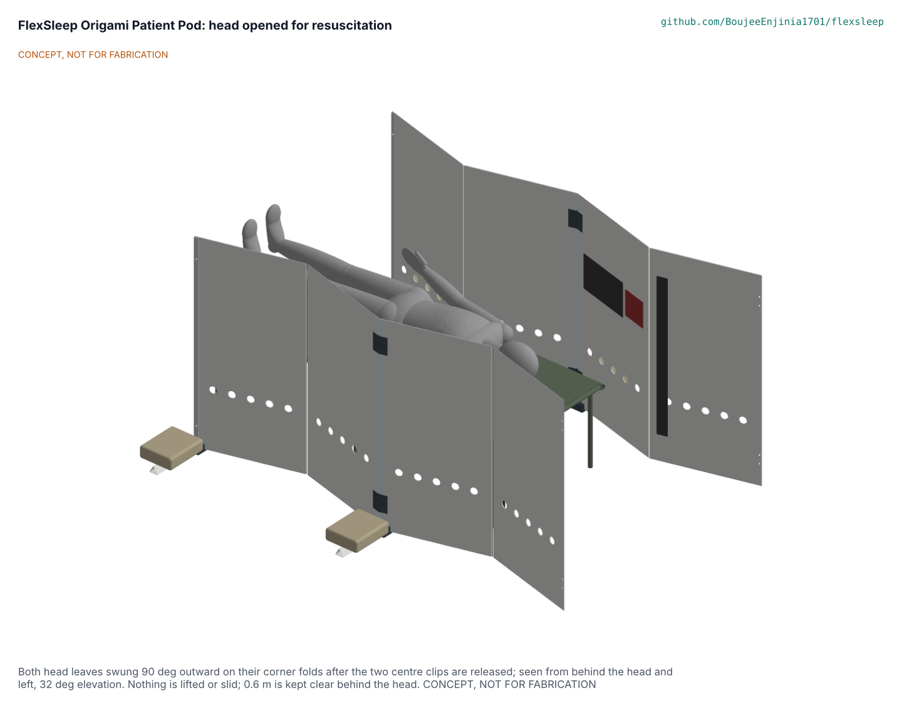
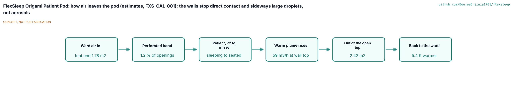
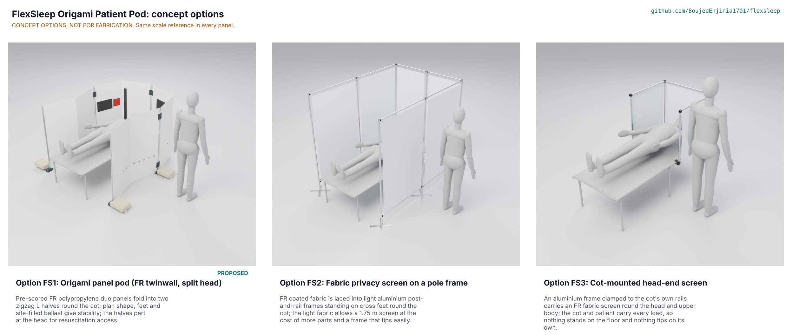
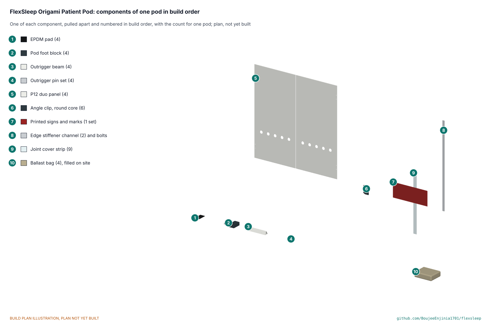

# FlexSleep Origami Patient Pod



CONCEPT, NOT FOR FABRICATION. [Studio view](media/render-studio.png) · [Exploded render](media/render-exploded.png) · [Concept render](media/hero.png)

    [](https://github.com/BoujeeEnjinia1701/flexsleep/actions/workflows/reuse.yml)

**Area:** Healthcare and emergency response · **TRL:** 3 of 9 (proof of concept on paper; stage P3) · **Value-engineering target:** USD 120 per pod (estimate USD 214.00) · **Difficulty:** 3 of 5 · **Partner:** Helpful Engineering

A flat-pack pod of folding flame-retardant polypropylene panels that one person sets round a field cot: two zigzag halves, 1.2 m high, open at the top and at the foot end, give a lying patient visual privacy and a physical boundary against direct contact and sideways splashes, keep the patient in view from the foot end, and open at the head in seconds for resuscitation. It supports a ward's infection prevention and control (IPC) practice; it is a boundary, not a barrier, and not a support. Built on the shared Flex panel and connector platform (FXP-PLT-001). The choice between this origami pod (FS1), a fabric screen on a pole frame (FS2) and a cot-mounted head-end screen (FS3) is **proposed, awaiting Amish**.

[Hero (concept render)](media/hero.png) · [Cutaway: head opened](media/cutaway.png) · [Exploded view](media/exploded.png) · [Air flow](media/flow.png) · [Interactive 3D model](media/viewer.html) · [Concept blueprint (PDF)](media/concept-blueprint.pdf) · [General arrangement FXS-DWG-001 (PDF)](cad/drawings/FXS-DWG-001.pdf) · [Foot FXS-DWG-002 (PDF)](cad/drawings/FXS-DWG-002.pdf) · [Sizing note FXS-CAL-001](docs/04-calcs/01-sizing.md) · [STEM check](docs/01b-stem-check.md) · [Prototype build plan](docs/05-build-plan.md) · [Decisions](docs/06-design-decisions.md) · [Review](docs/REVIEW.md)

## Concept rationale

In a surge ward cots stand in open rows: no privacy, and nothing between one patient's cough or hands and the next bed. A folding panel pod puts a 1.2 m wall round the head and sides of each cot, low enough for staff to see over and open enough that the patient's warm air rises out of the top. The physics sets the limits: a 600 mm twinwall leaf bows 25 mm at about 6 N, so a wall is never a handhold; aerosols follow the room air, so only a test can show an airborne effect; and 4 kg of polypropylene beside a mattress is the hardest fire case on the platform. This repo keeps the Helpful Engineering team's aim (pre-scored panels, snap joints, open top, one person, under 5 minutes, flat pack) and builds it round those numbers.

Design thesis: **privacy and a contact boundary at every bed from two sheets and a printer, that opens in seconds and never pretends to be a barrier or a rail.**

## Burning platform

- MSF plans about 4 m2 of ward space per bedridden patient, and "a 45 m2 tent can hold 10 beds + one nurse station" ([MSF cholera treatment centres](https://medicalguidelines.msf.org/en/viewport/CHOL/english/6-1-cholera-treatment-centres-ctc-25296944.html), checked 2026-11-12): dense open rows with no privacy.
- General wards are planned at "at least 2.5 metres" bed centre to bed centre with beds "separated by curtains" ([Bettercare, IPC facility design](https://bettercare.co.za/infection-prevention-and-control/05.html), checked 2026-11-12); field wards rarely have either.
- Large droplets exhaled by breathing travel under 1 m and by coughing more than 2 m (Xie et al. 2007, *Indoor Air* 17: 211-225); a boundary at the bed intercepts sideways splashes, while the evidence for partitions against airborne spread is "limited" ([Rooney et al. 2021](https://eprints.whiterose.ac.uk/181044/1/Evidence%20review%20of%20physical%20distancing%20and%20partition%20screens%20to%20reduce%20healthcare%20acquired%20SARS-CoV-2.pdf), checked 2026-11-12).

## Where it could be used

### By industry

| Industry | Use |
| --- | --- |
| Field hospitals and emergency medical teams | Privacy and a boundary at each cot in surge and outbreak wards |
| Displacement shelters | Personal space round a sick person's cot or mattress |
| Hospitals adding surge beds | Temporary bed spaces in halls and corridors |
| Local manufacturing | Sign shops cutting and printing FR twinwall; makerspaces printing clips and feet |

### By country or region

| Country or region | Why it matters there |
| --- | --- |
| Regions with recurrent cholera or respiratory outbreaks | Dense temporary wards (MSF ward space figures) |
| Displacement settings | Shelters without privacy infrastructure |
| North America and the UK | FR twinwall with NFPA 701 reports is sold there (FXP-PLT-001) |
| Hot climates and tents | Lost air movement and tent gusts to check (FXS-STM-001 S40, S44) |

## What sparked the idea

Helpful Engineering's FlexSleep Origami Patient Pod project proposed a flat-pack enclosure round a cot. Iteration 1 (an aluminium pole frame with rigid polycarbonate panels, four sides, a zipped entry and a HEPA unit) was dropped on weight, bulk and filter complexity; iteration 2 used three pre-scored corrugated polypropylene panels with a perforated lower band, semi-transparent upper panels and snap connectors. This repo takes that work to a constructable design with Design Molecule Labs on the shared Flex platform and tests its physics.

## Problem

Overcrowded emergency care puts patients in open shared sleeping space with no privacy and open contact and droplet paths. Field hospital operators, shelter managers and humanitarian health teams need a light, foldable micro-boundary round each cot that keeps patients in view and in reach ([FXS-PRB-001](docs/01-problem.md)).

## Concept



Four 1,200 x 1,200 mm folding panels make two mirror halves: each is a panel folded 60 deg at the head corner and a second panel clipped on at 150 deg, so the side walls zigzag and stand on their own. Inside, the pod is 1,170 to 1,483 mm wide (cots of 600 to 1,000 mm fit) and 1,913 mm long; the wall top is 1,212.5 mm. Four feet with pinned outriggers and 5 kg sand bags stand it up; aluminium channels stiffen the free ends; clear strips cover the joint gaps. Releasing two clips at the head centre lets both head leaves swing open on their folds (about 8 to 20 s on paper). A prohibition sign on each side wall says "Do not lean or pull. Ask staff to help you stand." ([FXS-PRC-001](docs/02-concept.md), [FXS-CAL-001](docs/04-calcs/01-sizing.md)).



## Concept options

Three working principles were modelled at detail level D3 and scored ([FXS-OPT-001](docs/02a-concept-options.md)): FS1 origami panel pod (149 of 235), FS2 fabric screen on a pole frame (141) and **FS3 cot-mounted head-end screen (171)**. FS3 leads by 15 % because the cot carries every load, so it cannot tip or give way under a patient, and it adds no floor; it screens only the head and upper body and sits near two active patents. Proposed, awaiting Amish: FS3 as the principle for the next stage; FS1, the team's concept, is carried in the drawings, BOM and build plan.



## STEM check

[FXS-STM-001](docs/01b-stem-check.md) answers the brief's questions with numbers. The walls stop 84.9 % of horizontal paths from a lying patient's mouth, but a supine cough goes up through the open top and aerosols follow the room air: no airborne effect is claimed until the decision-gate test. A 72 to 108 W patient drives 52 to 59 m3/h out of the open top, so heat is not trapped; lost air movement is the open thermal question. A lying patient is hidden from most of the aisle; a seated patient's head shows; staff observe from the foot end. The pod fits cots 60 to 100 cm wide. A wall gives way at about 10 N where a patient pulling up to stand needs 137 to 281 N, and the pod adds about 201 MJ of fire load beside a 144 MJ mattress: both go to Amish. Ten details were fixed under his standing instruction (F1 to F10), among them a round-core angle clip, pinned outriggers, a head that swings open, edge channels, joint strips and a prohibition sign. An independent reviewer agent attacked every verdict on 2026-11-12 (of 49 rows, 28 held, 17 weak, 4 refuted; 22 missed claims, added as S39 to S51).

## Key components

Four P12 duo panels (1,200 x 1,200 mm) from two 1,220 x 2,440 mm sheets of 4 mm FR polypropylene twinwall (at most 700 g/m2); six printed angle clips; four printed foot blocks with folded twinwall outriggers, stainless pins and rubber pads; four 5 kg sand bags filled on site; two aluminium edge channels with stainless bolts; nine clear joint strips; printed signs; one carry bag. Parts USD 214.00 ([bom/bom.csv](bom/bom.csv)); 7.4 kg to carry.

## Building the prototype

The [prototype build plan](docs/05-build-plan.md) (FXS-BLD-001) shows how to cut, groove, punch and seal the panels, print the clips and feet, fold the outriggers, cut the channels and set the pod round a cot in five steps, each with a picture, plus four joint close-ups and making sketches FXS-DWG-101 to 105. It is a plan, not yet built.



## Safety

The pod is a boundary, not a support: a wall gives way at about 10 N, so nobody may lean on, pull on or sit against it, and patients who need help to stand need staff, not the wall. Fire: keep candles, mosquito coils, lamps, chargers, heaters, oxygen cylinders and concentrators out of and off the pod, use only a sheet lot with its NFPA 701 and ASTM E84 reports, keep pods apart and the foot end clear. Keep 0.6 m clear behind the head so it can be opened; in an arrest release the two head clips and swing the head open, or pull the cot out of the open end. Indoor or in-tent use only, away from open tent doors and fans.

## Claims and limits

From the claims register [FXS-CLM-001](docs/12-claims.md):

- **May say now (design intent):** a physical boundary between beds against direct contact and sideways large droplets; visual privacy for a patient lying down; open top and foot end with observation from the foot end; fits cots 60 to 100 cm wide; opens at the head without tools; FR panels bought with NFPA 701 TM1 and ASTM E84 reports.
- **Only after testing:** any reduction in airborne particle exchange (the decision gate); set-up and release times; thermal comfort; reuse cycles and wipe resistance; fire behaviour beside a bed.
- **Never:** any claim that it prevents infection or transmission, works as an isolation space, is sterile, kills pathogens, is medical-grade, is approved by a regulator, is a barrier or a support, or is fire-safe.
- **Limits on the product:** not a barrier, not a bed rail or handhold; privacy lying down only, visual only; indoor or in-tent use; no ignition sources or oxygen equipment in or on it.
- **Release limitation:** no prototype is used in patient care until its stability, fire performance, cleanability and the procedure it embeds are reviewed by qualified IPC and safety staff.

## Helpful Engineering

This is a joint project of Design Molecule Labs and [Helpful Engineering](https://helpfulengineering.org), the global open engineering community. The Helpful Engineering FlexSleep Origami Patient Pod project team's update (problem, concept iterations 1 and 2, key assumptions, risks, the 60 to 90 day plan and the decision gate) is the source of this design; their concept is option FS1 here, and their plan, support needs and partners carry into [FXS-PLN-001](docs/11-plan.md).

## Repository layout

```
docs/                       controlled documents (PRB, STM, PRC, OPT, URS, PRS, RTM, CAL, BLD, DEC, REG, FEA, RSK, MKT, PLN, CLM, VER, FTO) and REVIEW.md
docs/platform/              shared Flex panel and connector platform FXP-PLT-001 (carried identically in FlexClean, FlexSleep, FlexTriage)
docs/04-calcs/              sizing.py (FXS-CAL-001), stem_check.py, results
docs/decisions/             decision records (concept selection, design for construction, STEM fixes)
docs/05-build-plan/         build plan pictures
cad/src/flex_parts.py       shared platform parts (do not edit here)
cad/src/model.py            parametric model, options FS1 to FS3 at detail level D3 (kit 1.9)
cad/src/sheets.py           drawings FXS-DWG-001 and 002, STL export
cad/src/build_plan_media.py build plan pictures and making sketches FXS-DWG-101 to 105
cad/src/concept_media.py    hero, cutaway, exploded, flow, 3D viewer, concept blueprint
cad/src/product_model.py    appearance model and render views (for Blender)
cad/step/, cad/stl/, cad/drawings/   exports
bom/bom.csv                 priced bill of materials
.kit/                       shared documentation kit 1.9.1-he (do not edit here)
```

## Documentation

Controlled documents follow the portfolio standards in [.kit/STANDARDS.md](.kit/STANDARDS.md), including the Helpful Engineering profile (section 25). `python .kit/render.py --check` validates them, `python .kit/cad_check.py --export` runs the CAD fidelity check, `python docs/04-calcs/sizing.py` and `python docs/04-calcs/stem_check.py` rerun the calculations, and `python .kit/trace.py` regenerates the traceability matrix.

## Credits

Amish Chadha, Lillian Fernandes, Raksha Thammaiah, Ali Raza, Michael Minn and Bart Combee (Design Molecule Labs with Helpful Engineering). AI assistance (Claude) was used for research, calculations, CAD and documentation; design direction and all decisions are Amish Chadha's, recorded in [docs/06-design-decisions.md](docs/06-design-decisions.md).

## Licenses

Following the [Helpful Engineering licensing guide](https://helpfulengineering.org/licensing-guide/):

- Hardware (CAD sources, STEP, drawings, BOM, build plan pictures): CERN-OHL-P-2.0, [LICENSE-HARDWARE.txt](LICENSE-HARDWARE.txt)
- Software (calculation scripts, kit tools, web viewer): Apache-2.0, [LICENSE-SOFTWARE.txt](LICENSE-SOFTWARE.txt)
- Documentation (controlled documents, README, renders and concept pictures): CC-BY-4.0, [LICENSE-DOCUMENTATION.txt](LICENSE-DOCUMENTATION.txt)

---

Design Molecule Labs with Helpful Engineering
