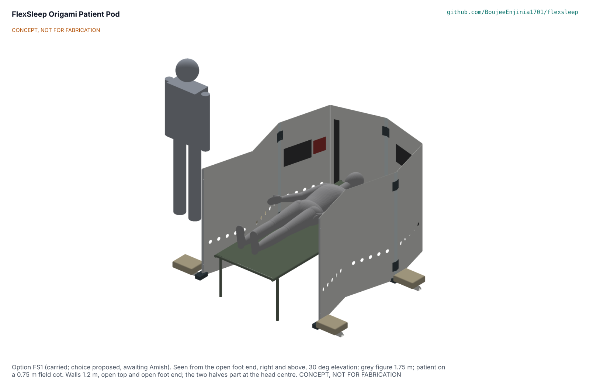

# FlexSleep Origami Patient Pod design precis

FlexSleep is a flat-pack pod of folding flame-retardant (FR) polypropylene panels that one person sets round a field cot: two zigzag halves, 1.2 m high, meet at the head and leave the top and the foot end open. It gives a lying patient visual privacy and a physical boundary against direct contact and sideways splashes, keeps the patient in view from the foot end, and opens at the head in seconds for resuscitation. It is a boundary, not a barrier, not a handhold and not an airborne measure. This precis describes option FS1, the team's iteration 2 made constructable on the shared Flex platform (FXP-PLT-001); the choice between FS1, FS2 and FS3 is proposed, awaiting Amish (FXS-OPT-001, FXS-DEC-001 D1). CONCEPT, NOT FOR FABRICATION.

Release limitation (STANDARDS 25.5b): no prototype is used in patient care until its stability, fire performance, cleanability and the procedure it embeds are reviewed by qualified infection prevention and control (IPC) and safety staff.

Figure 1. FS1 round a 0.75 m field cot, seen from the open foot end (model render; CONCEPT, NOT FOR FABRICATION).

## What it is

- **Panels:** four P12 duos (1,200 x 1,200 mm, FXP-S4FR 4 mm FR twinwall, flutes vertical) from two 1,220 x 2,440 mm sheets. Each half: one duo folded 60 deg at the head corner (head leaf and first side leaf), one duo on a 150 deg angle joint with its own 30 deg fold, so each side wall is a zigzag (platform rule S1). Print faces, with no grooves, face the patient.
- **Joints:** six platform angle clips on a round core (two at each side joint, two at the head centre), at 162.5 and 1,062.5 mm; clear PP strips over the 11.6 mm slit at every joint.
- **Feet:** four platform foot blocks at the side joints and free ends, each with one outrigger pinned to it on the outside and a 5 kg site-filled sand bag; EPDM pads underneath. No foot at the head centre.
- **Free ends:** an aluminium channel bolted over each free wall edge holds the last leaf straight.
- **Head release:** two clips at the head centre; released, both head leaves swing 90 deg outward on their corner folds. 0.6 m is kept clear behind the head wall.
- **Prints:** a prohibition sign and the words "Do not lean or pull. Ask staff to help you stand." on both side walls; a bed card; release marks at the head joint.
- **Team feature carried for decision:** a perforated band of forty 40 mm holes at 350 mm (FXS-DEC-001 D4 recommends dropping it).

Key figures (FXS-CAL-001): inner width 1,170 to 1,483 mm (cots 600 to 1,000 mm fit); wall top 1,212.5 mm; carried 7.4 kg, standing 26.6 kg; deploys in 4.2 to 8.3 min (estimate); head opens in 8 to 20 s (estimate); footprint 2.09 x 2.86 m with cot and head clearance; parts USD 214.00 against the USD 120 value-engineering target.

## How it works

The plan shape, the folds and the ballast stand the walls up, as the platform requires: no panel stands alone, every turn is 30 deg or more, and the outriggers and bags widen the base. A patient's warm plume (52 to 59 m3/h) leaves through the open top; ward air comes in at the open foot end. The walls stop 84.9 % of horizontal straight-line paths from a lying patient's mouth, which is where a cough or splash goes when the patient is on their side; a supine cough goes up, and aerosols follow the room air.

## Safety

> **Safety:** The pod is a boundary, not a support. A wall gives way at about 10 N; a patient pulling up to stand needs 137 to 281 N. It must not be used as a bed rail or handhold, and patients who need help to stand are a decision for Amish and the site (FXS-DEC-001 D2).

> **Safety:** Fire. The panels add about 201 MJ beside the bedding, 1.4 times a foam mattress, and stand inside a bed fire's flame. FR grade with NFPA 701 TM1 and ASTM E84 reports only; pods never touch; no candles, coils, lamps, chargers, heaters, oxygen cylinders or concentrators in or on a pod; oxygen patients only after the site's fire review; the foot end and 0.6 m behind the head stay clear (FXS-DEC-001 D7).

> **Safety:** Resuscitation. Staff release two clips and swing the head open; for full access they pull the cot out of the open foot end. A field cot is not a firm surface for compressions.

> **Safety:** Indoor or in-tent use, away from open tent doors and fans: a 5 m/s gust tips a free end (FXS-DEC-001 D9).

## What it does not do

It does not stop aerosols, give acoustic privacy, support a person, or prevent infection or transmission; no airborne figure is claimed until the decision-gate test (FXS-CLM-001).

Licence: this document is licensed under CC-BY-4.0 (Creative Commons Attribution 4.0 International), following the Helpful Engineering licensing guide. Design Molecule Labs with Helpful Engineering.
