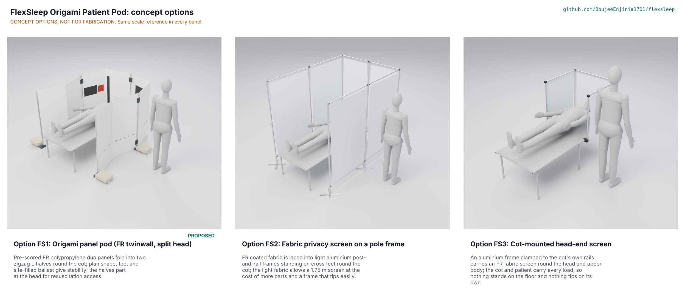

# FlexSleep Origami Patient Pod concept options

Three working principles were compared. **FS3, the cot-mounted head-end screen, scores highest (171 of 235), 15 % above FS1, the team's origami pod (149), with FS2, the fabric screen on a pole frame, last (141).** The margin comes from one fact: FS3 hangs on the cot, so a patient's pull or a bump cannot tip it and it takes no extra floor, while FS1 and FS2 stand on their own and tip at about 10 N. FS3 gives less privacy (head and upper body only), its clamps must be redesigned to lift off in seconds, and two active patents sit close to it. Recommendation: **proposed, awaiting Amish: develop FS3 as the principle for the next stage, grafting FS1's FR twinwall panels and printed faces onto it; FS1 is carried in the drawings, BOM and build plan now as the team's concept, because the repo is not redesigned without Amish's go** (FXS-DEC-001 D1). CONCEPT, NOT FOR FABRICATION.

Release limitation (STANDARDS 25.5b): no prototype is used in patient care until its stability, fire performance, cleanability and the procedure it embeds are reviewed by qualified IPC and safety staff.

Figure 1. The three options at one scale, each round the same 0.75 m field cot with a lying patient (rendered from `cad/src/model.py` with Blender; CONCEPT, NOT FOR FABRICATION).

## The options

- **FS1 Origami panel pod (team concept, iteration 2):** four FXP-S4FR P12 duos in two zigzag halves round the cot, 1.2 m high, open top and foot end, clip-lock joints, four pinned feet with bags; the head opens by releasing two clips. 68 parts at D3; 7.4 kg carried; USD 214.00 in parts.
- **FS2 Fabric privacy screen on a light pole frame:** FR coated fabric laced into aluminium post-and-rail frames 1.75 m high on cross feet, in the same U plan. 91 parts at D3; 11.9 kg; about USD 422 for two retail screens.
- **FS3 Cot-mounted head-end screen:** four aluminium uprights clamped to the cot's side rails carry a top frame at 1.2 m and an FR fabric screen round the head and 0.7 m along each side; open top, foot and legs. 34 parts at D3; 2.4 kg; cost to assess.

STEM rows: FS1 in FXS-STM-001 Table 1 (S1 to S51); FS2 and FS3 in Table 2 (X1 to X10); the P18 variant of FS1 in X11.

## Scoring

Weights: High 3, Medium 2, Low 1 (FXS-URS-001), plus buildability with local skills (Medium). Scores 1 to 5.

Table 1. Weighted scoring.

| Criterion | Weight | FS1 | FS2 | FS3 | Reason |
| --- | --- | --- | --- | --- | --- |
| UR-001 One-person set-up | 3 | 3 | 3 | 4 | FS1 4.2 to 8.3 min estimated; FS2 has 7 posts and 12 rails; FS3 four clamps |
| UR-002 Fits our cots | 3 | 4 | 4 | 3 | FS1 1,170 mm inner width; FS3 clamps depend on the cot's rail shape |
| UR-003 Privacy lying down | 3 | 4 | 5 | 3 | FS2 1.75 m hides more; FS3 screens the head and chest only |
| UR-004 Staff can see the patient | 3 | 4 | 2 | 4 | 1.2 m walls are seen over; FS2 hides the patient except from the foot end |
| UR-005 Boundary between beds | 3 | 4 | 4 | 3 | FS1 84.9 % of horizontal paths; FS3 covers the head end only |
| UR-006 Access in an emergency | 3 | 3 | 3 | 3 | FS1 8 to 20 s head release but 210 mm side gaps; FS3 open sides but clamps to redesign |
| UR-007 Does not fall or give way | 3 | 1 | 1 | 4 | FS1 free end 11 N, FS2 side frame 3.5 to 12 N; FS3 carried by the cot |
| UR-008 Fire | 3 | 2 | 3 | 4 | FS1 201 MJ of PP round the bed; FS2 about 2 kg of coated fabric; FS3 about 0.6 kg, but at the pillow |
| UR-009 Not too hot | 2 | 4 | 3 | 4 | Open tops; FS2 taller |
| UR-010 Cleanable | 3 | 3 | 3 | 3 | Sealed twinwall versus coated fabric and tube joints |
| UR-011 Packs flat, one carry | 2 | 4 | 2 | 4 | 40 mm of panels; FS2 tubes 1.75 m long |
| UR-012 Many uses | 2 | 3 | 4 | 4 | Twinwall folds unproven over 50 cycles; tube and fabric are known |
| UR-013 Affordable | 2 | 2 | 1 | 3 | USD 214 parts; USD 422 retail; FS3 to assess (small parts count) |
| UR-014 Ward density | 2 | 2 | 2 | 5 | FS1 6.2 pods per 45 m2 against 10 beds; FS3 adds no floor |
| UR-015 Not isolating | 2 | 3 | 3 | 4 | FS3 is the most open |
| UR-016 Honest claims | 3 | 4 | 4 | 4 | Same claims rule |
| UR-017 Getting out | 3 | 3 | 3 | 4 | FS1 and FS2 exit over the cot end; FS3 sides open |
| Buildability with local skills | 2 | 4 | 3 | 3 | Sign shop and printer; FS2 and FS3 need tube work and clamps |
| **Weighted total (of 235)** | | **149** | **141** | **171** | FS3 15 % above FS1; FS1 5 % above FS2 |

FS1 and FS2 are within 10 % of each other; FS3 is not within 10 % of either. Because FS3 outscores the team's concept, the choice goes to Amish (STANDARDS 21) and the repo carries FS1 until he decides.

## Best ideas to graft

- From FS3 onto FS1: let the cot carry the loads. An FS1 variant whose head and side walls are clipped to a cot-mounted frame would remove the tipping and pull failures (S10, S11) at the cost of a cot-specific clamp.
- From FS1 onto FS3: wipeable FR twinwall panels and printed faces instead of fabric, if their mass and fire case on a cot frame check out.
- From FS2: a taller screen only on the head end, where privacy matters most, if the site wants seated privacy (D3).

## Risks and co-design needs

- FS1: patient pull and fire (FXS-DEC-001 D2, D7); density; acceptance. Needs a field hospital to try the release drill and the layout.
- FS2: tipping at a touch, retail cost, fabric fire report.
- FS3: clamp fit to each cot type, lift-off release, privacy only at the head, patents US 11,369,208 B2 and US 12,213,925 B2 (FXS-FTO-001). Needs cot samples from MSF or IRC.

Licence: this document is licensed under CC-BY-4.0 (Creative Commons Attribution 4.0 International), following the Helpful Engineering licensing guide. Design Molecule Labs with Helpful Engineering.
