# FlexSleep Origami Patient Pod prototype build plan

Plan, not yet built.

This plan tells a capable maker how to build one proof-of-concept pod of option FS1 round a field cot, component by component, in build order. It is written before anything is built and records no results. Open decisions and items to confirm are in the design decisions register (FXS-DEC-001). CONCEPT, NOT FOR FABRICATION.

Release limitation (STANDARDS 25.5b): no prototype is used in patient care until its stability, fire performance, cleanability and the procedure it embeds are reviewed by qualified IPC and safety staff.

## 1. What you are building

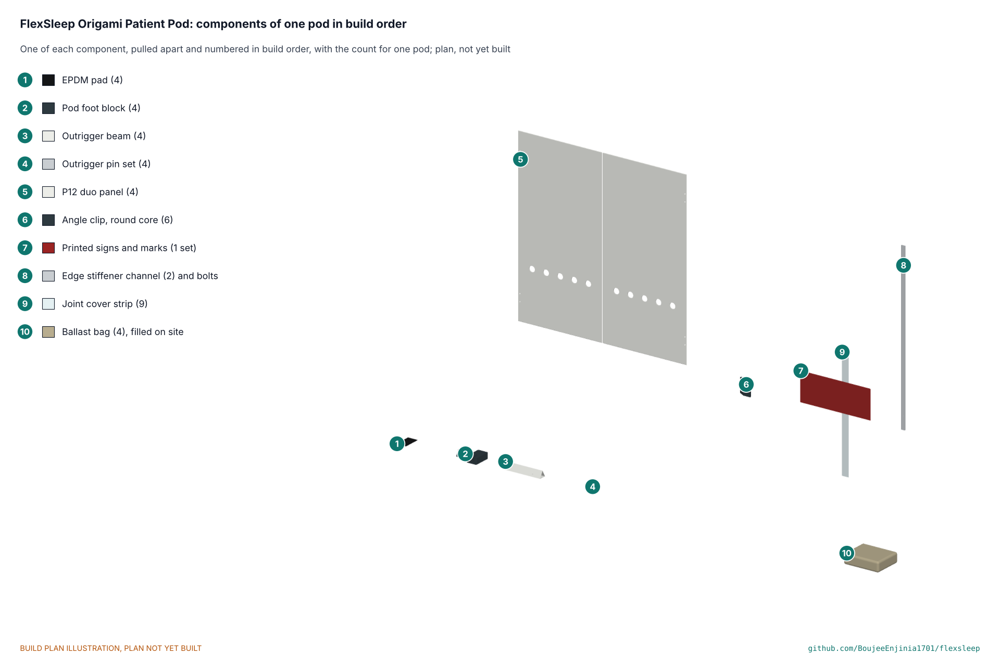

Figure 1. One of each component, numbered in build order, with the count for one pod.

A pod of four folding panels of 4 mm flame-retardant polypropylene twinwall, 1.2 m high, in two mirror halves round a field cot: each half is a panel folded at the head corner and a second panel clipped on at the side, so each side wall zigzags. Six printed clips join the panels; four printed foot blocks with folded outriggers, rubber pads and sand bags stand them up; two aluminium channels stiffen the free ends; clear strips cover the joint gaps. The two clips at the head centre release so the head can swing open. Parts cost about USD 214 at prototype quantities.

## 2. What changed to make it buildable

| Concept had | Buildable design has | Why |
| --- | --- | --- |
| Three panels | Four panels in two halves meeting at the head centre | Standard 1,200 mm panels; the head must open |
| Flat side walls | Zigzag side walls (30 deg turns) | A flat 1.2 m panel edge must be held |
| Snap connectors | Angle clips with a round core | The square-core clip blocks the angled slot |
| No feet shown | Four feet with pinned outriggers, pads and sand bags; none at the head | Stability; the head swings open |
| Free wall ends | Aluminium channels over the free edges | A free edge buckles when hot |
| Joint gaps | Clear cover strips | Gaps of about 12 mm at each angled joint |

## 3. Making the components

### 3.1 Panel (four)

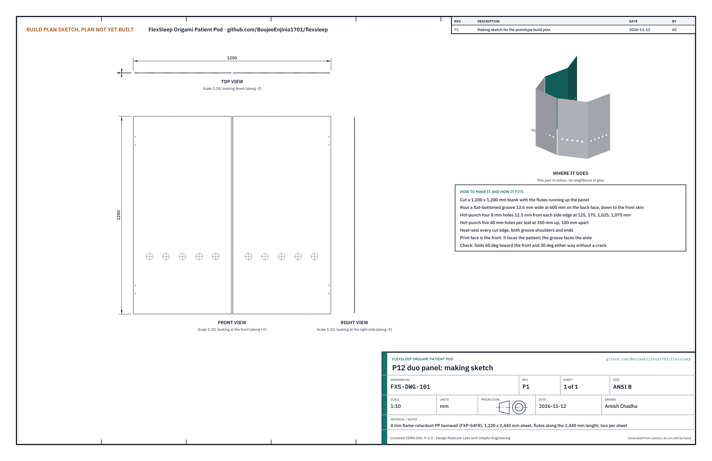

Made from 4 mm flame-retardant twinwall, white, with the supplier's fire reports, 1,220 x 2,440 mm sheets with the flutes along the length; two panels per sheet.

1. Mark a 1,200 x 1,200 mm square with the flutes running up the panel; cut it.
2. On the back face, rout a flat-bottomed groove 13.6 mm wide at 600 mm from one edge, down to the front skin, the full height.
3. Hot-punch four 8 mm holes 12.5 mm in from each outer side edge, at 125, 175, 1,025 and 1,075 mm up.
4. Hot-punch five 40 mm holes on each leaf at 350 mm up, 100 mm apart, starting 100 mm from the leaf's outer edge (team feature; may be dropped).
5. Heat-seal every cut edge, both groove shoulders and ends, so no flute is open.
6. Apply the printed film to the front face of the two side leaves and head leaves as the print card shows, at least 25 mm from holes and never across the fold.

How it fits: each outer edge slides 40 mm into a clip slot until it meets the core and the two pegs drop into its holes; the bottom edge drops into a foot slot. The front face, with no groove, faces the patient.

Check: the panel folds to 60 deg toward the front and 30 deg either way without a crack in the front skin.

### 3.2 Angle clip (six)

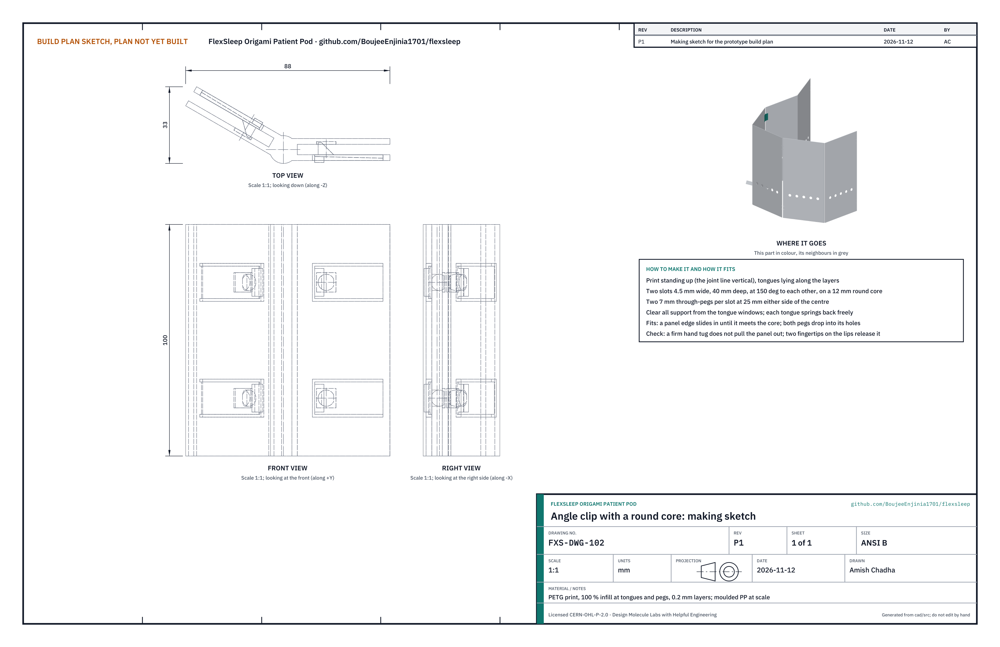

Printed in PETG, solid at the tongues and pegs, standing up with the tongues along the layers.

1. Print; remove all support from the tongue windows; each tongue must spring back freely.
2. Check both slots take a 4 mm offcut and that both pegs drop into its holes.

How it fits: two panel edges, at 150 deg to each other, each slide into a slot; two clips per joint, 162.5 and 1,062.5 mm above the floor.

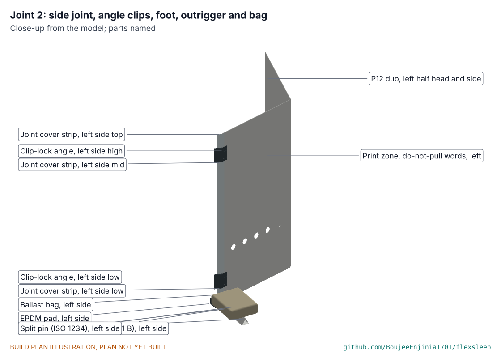

Figure 2. Side joint: two clips, the foot, outrigger and bag.

Check: a firm hand tug does not pull a panel out; two fingertips on the two lips and a pull on the panel release it.

### 3.3 Foot block (four)

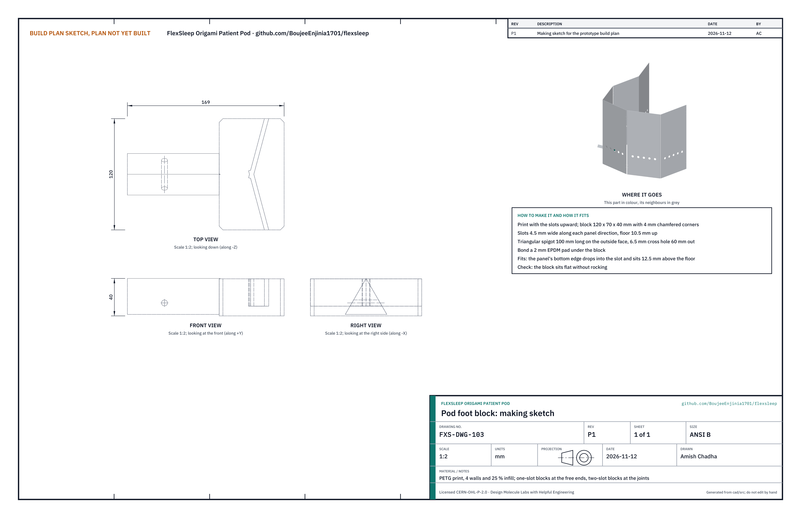

Printed in PETG, four walls and 25 % infill: two blocks with two slots for the side joints, two with one slot for the free ends.

1. Print slots up; block 120 x 70 x 40 mm; slots 4.5 mm wide, floor 10.5 mm up.
2. Ream the 6.5 mm cross hole in the triangular spigot on the outside face.
3. Bond a 2 mm EPDM pad, 118 x 68 mm, under the block.

Check: the block sits flat without rocking; a panel offcut drops into each slot.

### 3.4 Outrigger (four)

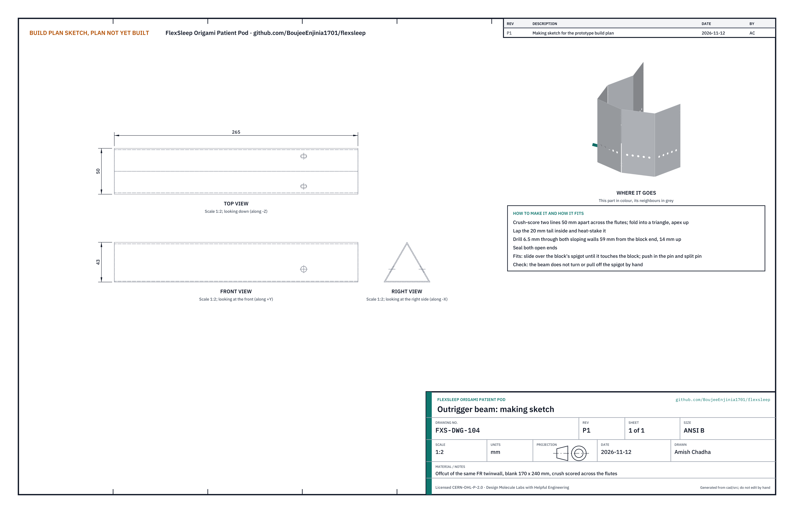

Folded from a 170 x 240 mm offcut of the panel sheet.

1. Crush-score two lines 50 mm apart across the flutes; fold into a triangle, apex up; heat-stake the 20 mm lap inside.
2. Drill 6.5 mm through both sloping walls, 59 mm from the block end and 14 mm up; seal both ends.
3. Slide it over the block's spigot until it touches the block; push the 6 mm stainless pin across and fit its split pin.

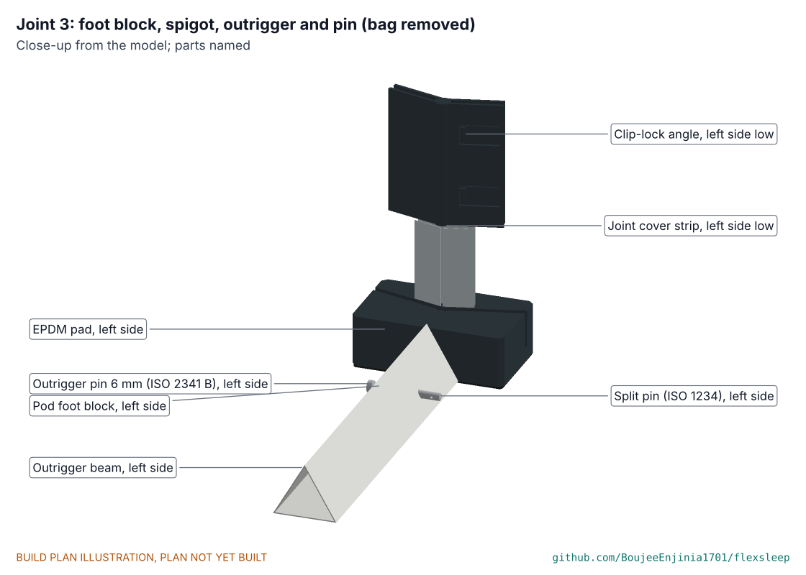

Figure 3. Foot block, spigot, outrigger and pin.

Check: the outrigger does not turn or pull off by hand.

### 3.5 Edge channel (two)

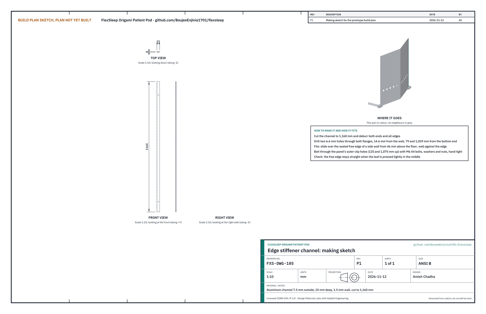

Cut from aluminium channel 7.5 mm outside, 25 mm deep, 1.5 mm wall.

1. Cut to 1,160 mm; deburr.
2. Drill two 6.6 mm holes through both flanges, 14.6 mm from the web, 79 and 1,029 mm from the bottom end.

How it fits: it slides over the sealed free edge of a side wall from 46 mm above the floor and is bolted through the panel's outer clip holes with stainless M6 bolts, washers and nuts.

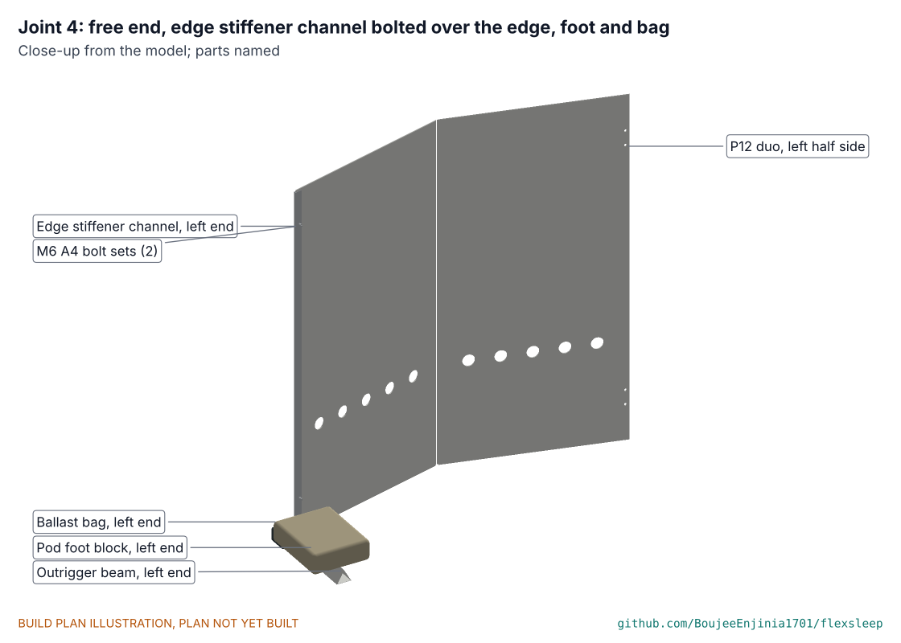

Figure 4. Free end: channel, bolts, foot and bag.

Check: the edge stays straight when the leaf is pressed lightly at mid-height.

### 3.6 Bought parts

- Clear PP strip film 0.3 mm, cut to 48 mm wide in three lengths per joint (about 65, 790 and 90 mm) and creased lengthwise to follow the 150 deg joint; heat-staked to one leaf only.
- Four sealed, wipeable ballast bags, filled with 5 kg of clean sand each away from the ward.
- Printed film set: two prohibition signs with the words "Do not lean or pull. Ask staff to help you stand.", one bed card, two release marks.
- A flat carry bag about 650 x 1,250 mm.

## 4. Putting it together

Step 1. Mark the pod's outline round the cot on the floor with the cot pulled 0.5 m forward, 0.6 m clear behind the head line; set the four feet with outriggers pointing outward.

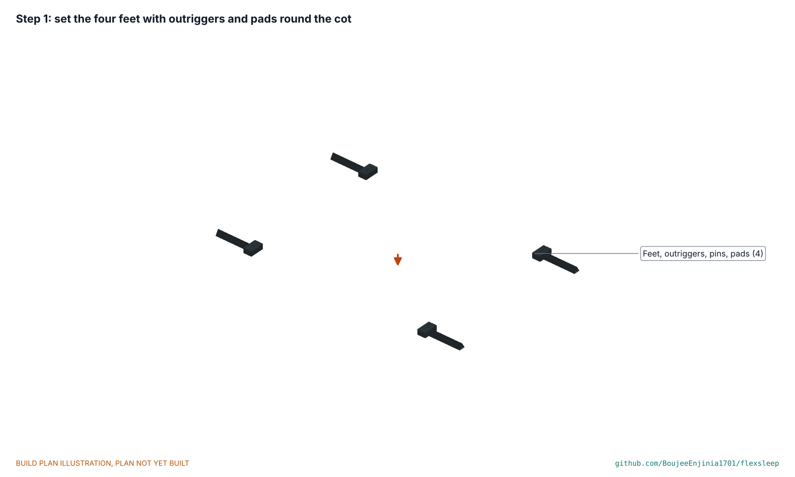

Step 2. Fold the left head-and-side panel to 60 deg and stand it in the side-joint foot; stand the second left panel, folded 30 deg, in the side-joint and free-end feet; push in the two side-joint clips; bolt the edge channel over the free edge.

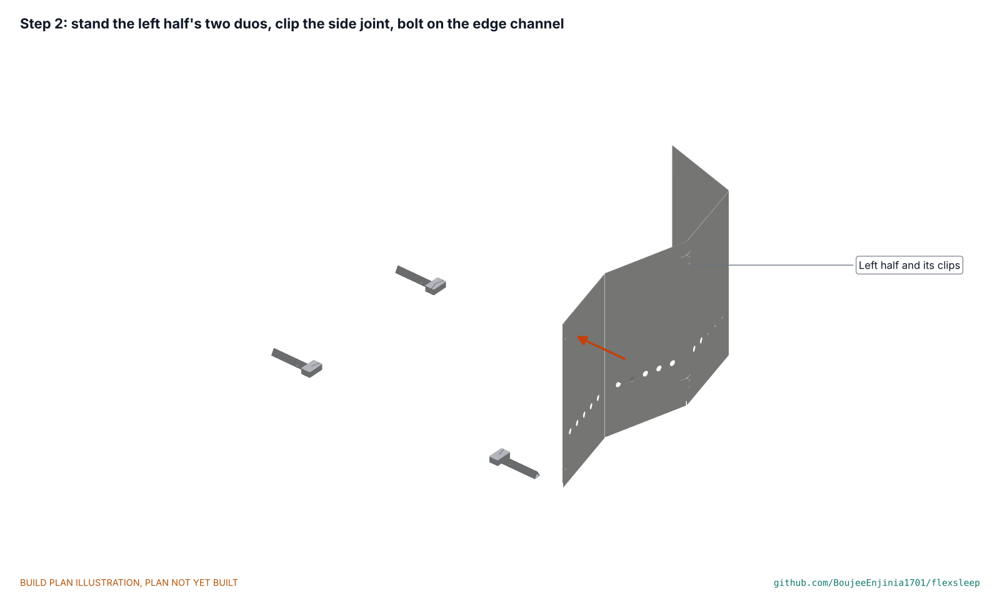

Step 3. Do the same for the right half.

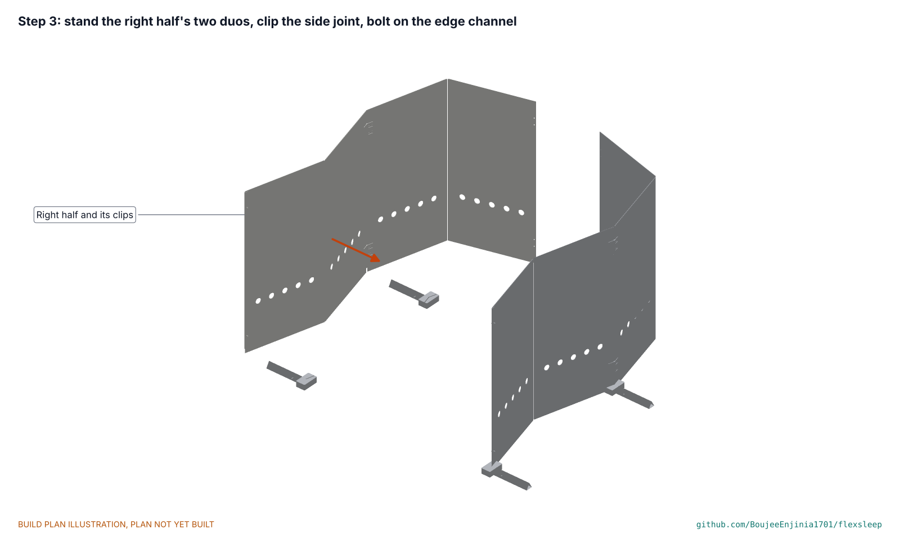

Step 4. Bring the two head leaves together and push in the two head-centre clips; fit the cover strips at all three joints.

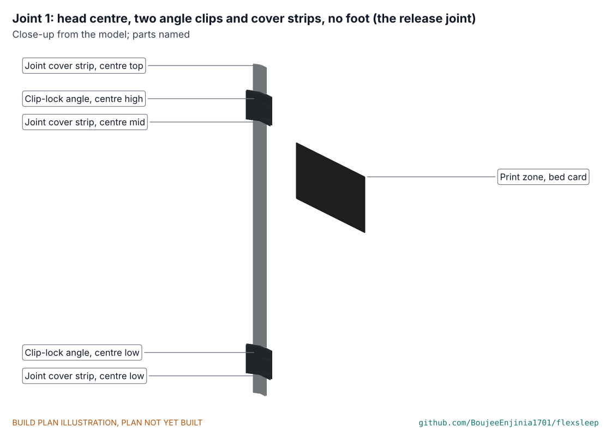

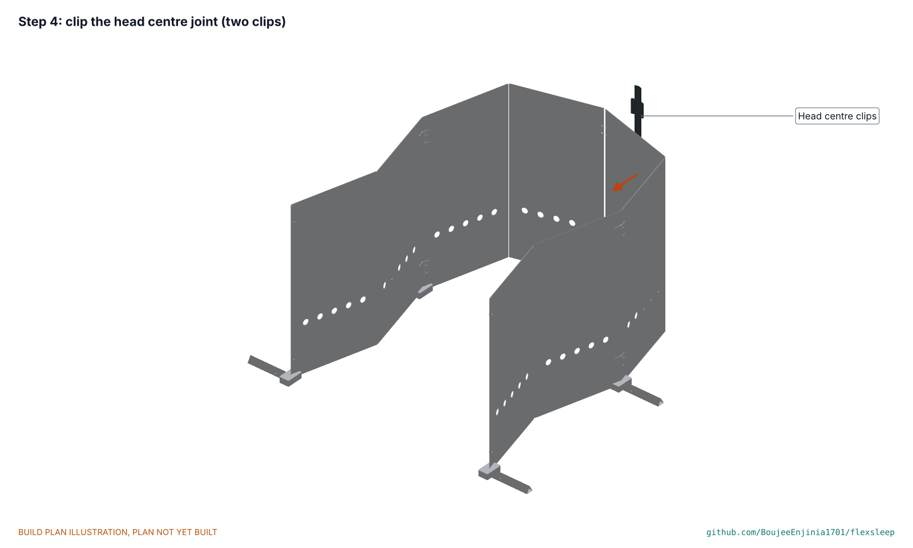

Step 5. Lay a filled bag on each outrigger; push the cot back so its head is 260 mm from the head line; check the signs face the patient.

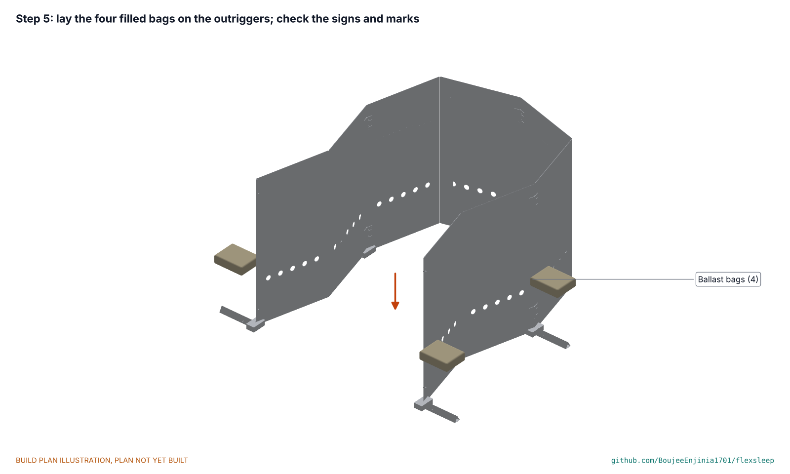

Hold point: before step 5, check that both halves stand alone as L shapes and that nothing is clipped to the cot.

## 5. First checks

| Check | Requirement | Pass criterion |
| --- | --- | --- |
| Cots of 600, 750 and 1,000 mm fit with a hand gap each side | PR-002 | At least 75 mm a side |
| Wall top height | PR-003 | 1,200 mm or more |
| Head release by one person, timed | PR-006 | Under 30 s, nothing lifted or slid |
| Set-up by one untrained person, timed | PR-001 | Under 5 min, empty cot, bags staged |
| Occupied-cot pull-out through the open foot end | PR-017 | Cot clears the pod |
| Edge stays straight | PR-019 | No visible bow at mid-height |
| Signs present and readable | PR-018 | Both walls |

## 6. Safety stops

- Stop before anyone lies in the pod: the release limitation applies; this is a fit and drill build only.
- Stop if any panel lacks its fire reports or a cut edge is unsealed.
- Stop if a wall leans or a foot rocks: re-seat before going on.
- Never lean on or pull a wall during checks; never stand a single panel unsupported.
- No heat, flame, lamp or charger near the panels.

## 7. Tools, skills and workspace

A sign shop's flat-bed cutter or a straightedge and knife, a router with a flat 13.6 mm cutter set to leave the front skin, a hot punch and an edge sealer; a desktop printer for PETG; a hacksaw, file and drill for the channels; hex keys and spanners for M6. A clean floor 3 x 3.5 m.

## 8. Where the numbers come from

`cad/src/model.py`, `cad/src/build_plan_media.py`, `cad/drawings/FXS-DWG-001` to `002` and `101` to `105`, `cad/stl/`, FXS-CAL-001 (`docs/04-calcs/01-sizing.md`, `sizing.py`), `bom/bom.csv`, FXP-PLT-001.

Licence: this document is licensed under CC-BY-4.0 (Creative Commons Attribution 4.0 International), following the Helpful Engineering licensing guide. Design Molecule Labs with Helpful Engineering.
